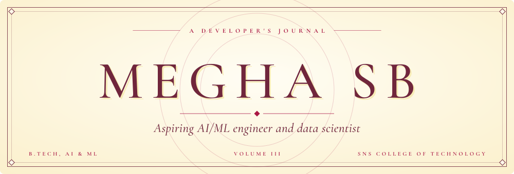

  

  <i>Curious about how systems think, careful about how they're built.</i>

  <a href="https://github.com/meghaaa111?tab=repositories"><b>Browse my repositories</b></a>
  &nbsp;&nbsp;|&nbsp;&nbsp;
  <a href="#connect-with-me">Get in touch</a>

### About

I'm a third-year B.Tech student in Artificial Intelligence and Machine Learning at SNS College of Technology, India. I like the point where a model stops being an idea and becomes software that actually runs, and I'm working toward a career as an AI/ML engineer and data scientist.

Everything I build lives in my repositories. This page is the part that doesn't fit in a commit message.

### Currently exploring

- Machine learning and more advanced AI applications
- Large language models and generative AI
- AI agents and intelligent automation
- Data structures and algorithms
- Turning ideas into practical software products

### Technical skills

**Languages**&nbsp;

**AI / ML**&nbsp;

**Visualisation**&nbsp;

**Tools**&nbsp;

### Activity

  
  

  

### Beyond the code

- **Hackathons.** I like building against the clock, where tight constraints force clearer thinking.
- **Learning.** I pick things up by taking them apart and putting them back together.
- **Experimentation.** Small, throwaway prototypes are how I find out what's worth building properly.
- **Creative problem-solving.** The best solution is often the one nobody drew on the whiteboard first.

### Connect with me

[LinkedIn](https://www.linkedin.com/in/megha-s-b-aiml/) &nbsp;|&nbsp; [Email](mailto:meghasb2007@gmail.com) &nbsp;|&nbsp; [Portfolio](https://meghaaa111.github.io/)

<i>Less noise. More personality. Strong engineering.</i>

